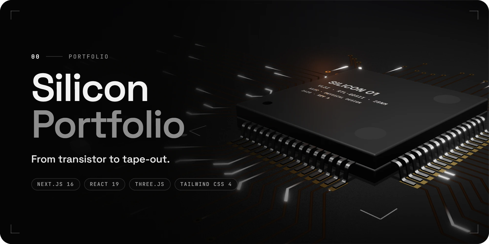
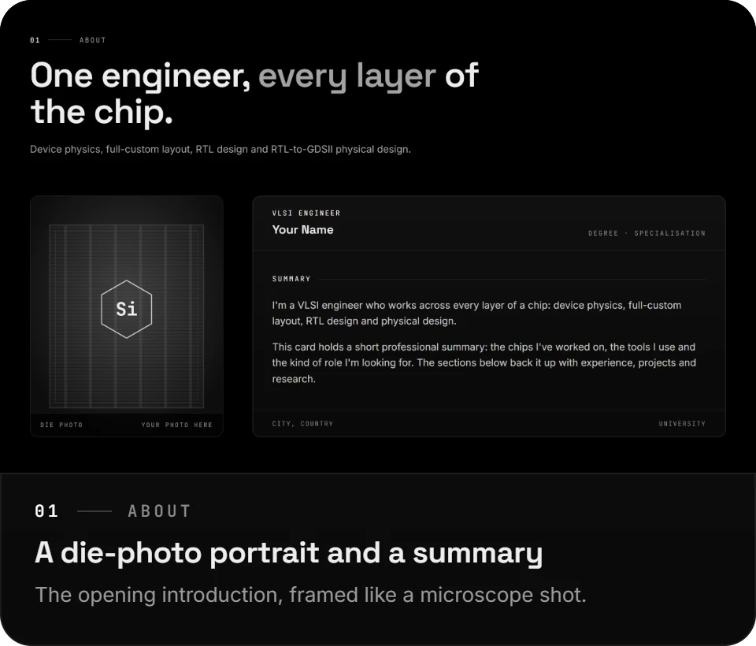
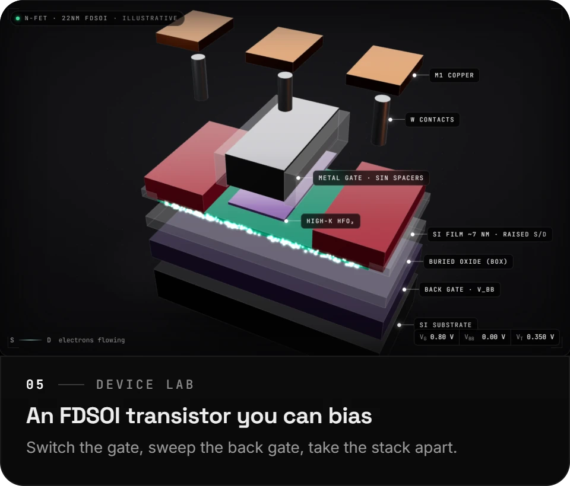

<p align="center">
  
</p>

<p align="center">
  <b>A portfolio website for a chip-design (VLSI) engineer, built around the chip itself.</b><br />
  Scroll through a 3D chip, bias a live transistor and read the work behind it.
</p>

<p align="center">
  
  
</p>


## Overview

The site is a single scrolling page. It opens on a 3D chip package: as you scroll, the lid comes off and the camera travels across the silicon die, where each block stands for one role in the experience section. Further down, an interactive transistor shows the device physics behind the work.

Every 3D model is generated in code, with no model files or textures. Each scene loads just before it scrolls into view and stops rendering once it leaves the screen, so scrolling stays smooth on laptops and phones.

Built with Next.js 16, React 19, React Three Fiber, Tailwind CSS 4 and Motion. The contact form uses EmailJS, so there is no backend.

## On the page

**Hero :**&ensp;The chip package. Scrolling lifts the lid and tours the die, one block per role.<br />
**About :**&ensp;A portrait framed like a die photo, beside a short professional summary.<br />
**Experience :**&ensp;Each role drawn as a digital signal, high while it was active.<br />
**Skills :**&ensp;Grouped like the pin diagram in a chip datasheet. Hover a group to light its pins.<br />
**Projects :**&ensp;Project cards illustrated with generated chip-layout artwork.<br />
**Device Lab :**&ensp;The interactive transistor, with live readouts and a current–voltage graph.<br />
**Education :**&ensp;Degrees and coursework beside a 3D model of the silicon crystal lattice.<br />
**Publications :**&ensp;Google Scholar figures on a small circuit board, then the papers.<br />
**Resume :**&ensp;A preview of the resume with a PDF download.<br />
**Contact :**&ensp;A terminal-style message form. Messages arrive by email.

## Run locally

You need Node.js 20.9 or newer.

```bash
npm install
npm run dev
```

Then open [http://localhost:3001](http://localhost:3001).


**Production build.**

```bash
npm run build
npm start
```

## Project structure

```
src/
├── app/              Page, layout and global styles (theme colours live in globals.css)
├── components/
│   ├── sections/     One component per section of the page
│   ├── three/        The 3D scenes: chip, transistor, crystal lattice, theme switch
│   ├── layout/       Navigation bar, theme switch and footer
│   └── ui/           Shared building blocks
├── content/          All text and data shown on the site
└── lib/              Theme, contact form and small helpers
public/               Fonts for the 3D text, the portrait and the resume PDF
```

To update the content, edit the files in `src/content/`. The layout picks up the changes automatically.

<br />

<p align="center"><sub>From transistor to tape-out.</sub></p>
